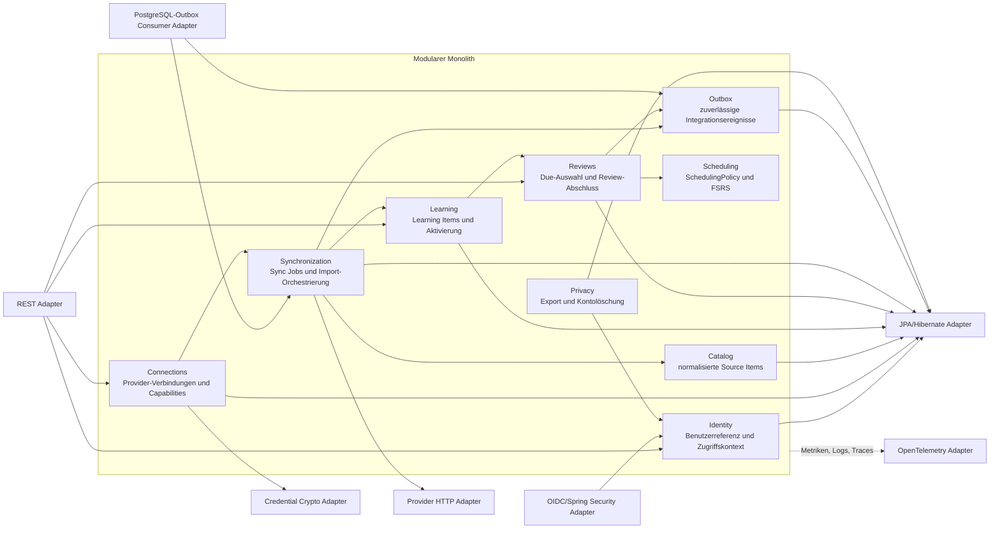

# C4 Level 3 – Backend-Komponenten

## Struktur

API und Worker verwenden einen modularen fachlichen Kern. Module kommunizieren über veröffentlichte Application Ports oder explizite Domain/Integration Events. Direkte Zugriffe auf interne Pakete anderer Module sind verboten.

Die C4-Komponenten sind fachliche Verantwortungsgrenzen und müssen nicht in jeder Ausbaustufe jeweils ein eigenes Spring-Modul bilden. Der Phase-3-Slice bündelt Catalog-, Learning- und Review-Verantwortung zunächst im Spring-Modul `learning`, damit das Erzeugen von `SourceItem`, `LearningItem` und erster `ReviewCard` eine kleine atomare Transaktion bleibt. Die drei Domänenkonzepte und ihre Persistenzmodelle bleiben getrennt. Ein späterer Modulsplit benötigt einen konkreten unabhängigen Änderungs- oder Teamgrund.

Phase 5 bündelte Connections und den zunächst synchronen Sync-Use-Case im
Spring-Modul `integration`. Es greift ausschließlich über das veröffentlichte
`learning::api` auf den idempotenten Import zu und kennt keine Learning-
Repositorys. Externe Codewars-Aufrufe laufen außerhalb von Transaktionen;
Seitenimport, SyncJob-Übergang und Cursorfortschritt besitzen kurze getrennte
Transaktionsgrenzen. Phase 6 trennt Annahme und Verarbeitung: Die API persistiert
SyncJob und Outbox-Event atomar, der Worker least das Event und verwendet
unverändert `ProviderConnector` und `learning::api`.

## Fachliche Module

### Identity

Verantwortet:

- Zuordnung des OIDC-Subjects zum internen `AppUser`,
- aktuellen Benutzer- und Rollen-Kontext,
- gemeinsame Autorisierungsprimitiven.

Verantwortet nicht:

- Passwörter,
- OIDC-Protokollimplementierung,
- Provider-Verbindungen zu Lernplattformen.

### Connections

Verantwortet:

- Lebenszyklus einer `ProviderConnection`,
- Verbindungsart und Provider-Capabilities,
- verschlüsselte Credential-Payloads,
- Validierungs- und Trennvorgänge.

### Catalog

Verantwortet:

- normalisierte `SourceItem`-Metadaten,
- Identität aus Provider und externer ID,
- globale Metadaten ohne benutzerspezifischen Lernzustand.

### Learning

Verantwortet:

- benutzerspezifische `LearningItem`-Objekte,
- eigene Notizen und erstmaligen Abschlusszeitpunkt,
- Aktivierung und Archivierung,
- Erzeugung gewünschter Review Cards über veröffentlichte Use Cases.

### Reviews

Verantwortet:

- Auswahl fälliger Review Cards,
- Start und Abschluss eines Reviews,
- unveränderliche Review Logs,
- Idempotenz und konkurrierende Updates,
- Anwendung des Ergebnisses einer `SchedulingPolicy`.

### Scheduling

Verantwortet:

- schedulerunabhängige Zustands- und Ergebnistypen,
- `SchedulingPolicy`-Vertrag,
- versionierte FSRS-Implementierung,
- deterministische Berechnung ohne I/O.

Das Modul kennt weder HTTP, Datenbank, Benutzeroberfläche noch Provider.

### Synchronization

Verantwortet:

- `SyncJob`-Lebenszyklus,
- Orchestrierung von Connector, Normalisierung und Import,
- Cursor, Pagination und Importstatistik,
- Retry-Klassifikation und Fehlerzustände.

### Outbox

Verantwortet:

- atomare Persistenz veröffentlichungsfähiger Ereignisse,
- Veröffentlichung und Zustellstatus,
- technische Deduplizierung der Veröffentlichung,
- konkurrierendes Leasing mit `FOR UPDATE SKIP LOCKED`,
- begrenzte Retries, Backoff/Jitter und Dead-Letter-Zustand.

### Privacy

Verantwortet gemäß [ADR-0019](../adr/0019-atomic-privacy-lifecycle.md):

- den versionierten Export eigener Fachdaten,
- die atomare vollständige Kontolöschung,
- die explizite Abgrenzung zum externen OIDC-Account,
- datensparsame Audit-Logs und fachliche Metriken.

Der JDBC-Adapter darf ausschließlich für diesen vollständigen
Datenschutzvorgang Tabellen mehrerer Module lesen und löschen. Er hängt nicht
von deren internen Java-Paketen oder Repository-Adaptern ab.

## Ports und Adapter

Vorgesehene Ports:

- `SchedulingPolicy`
- `ProviderConnector`
- modulbezogene Repository Ports
- `DomainEventPublisher` beziehungsweise Outbox-Port
- `CredentialCipher`
- `CurrentUser`
- `Clock`

Ports bleiben klein und use-case-orientiert. Ein allgemeines Universal-Repository, Universal-HTTP-Client oder serviceübergreifendes God Interface ist ausgeschlossen.

## Abhängigkeitsregeln

1. Domainpakete hängen nicht von Spring, JPA, AWS SDK oder HTTP-Modellen ab.
2. Adapter hängen von Ports ab; Ports kennen ihre Adapter nicht.
3. REST-DTOs, Provider-DTOs, Persistenzmodelle und Domainobjekte sind unterschiedliche Verträge.
4. Kein Modul greift direkt auf Repository-Adapter eines anderen Moduls zu.
5. Scheduling bleibt deterministisch und verwendet eine injizierte Zeitquelle.
6. Modulinterne Events sind nicht automatisch öffentliche Integrationsereignisse.
7. Architekturregeln werden durch ArchUnit und Spring Modulith überprüft.

## Transaktionsgrenzen

- Ein Use Case definiert eine fachliche Transaktionsgrenze.
- Review-Abschluss, ReviewLog und neuer Card-Zustand werden atomar gespeichert.
- Import-Upserts und Cursor-Fortschritt werden so geschnitten, dass ein Retry keinen Datenverlust oder Dubletten erzeugt.
- Outbox Events entstehen in derselben Datenbanktransaktion wie die zugehörige Fachänderung.
- Externe HTTP-Aufrufe werden nicht innerhalb lang laufender Datenbanktransaktionen ausgeführt.
