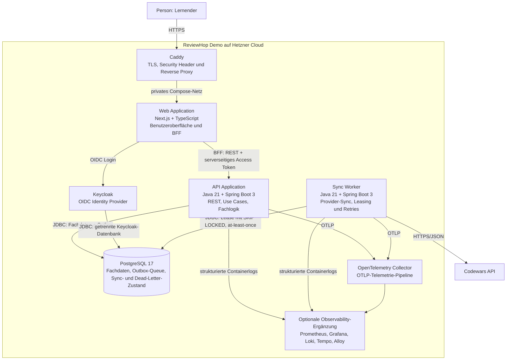

# C4 Level 2 – Container

## Übersicht

ReviewHop besteht aus einem Web-Frontend, einer Spring-Boot-API, einem getrennten
Spring-Boot-Worker und PostgreSQL. Der fachliche Kern ist ein modularer Monolith.
API und Worker verwenden dasselbe versionierte Image und dieselben fachlichen
Module, laufen aber als getrennte Prozesse. PostgreSQL implementiert gemäß
[ADR-0017](../adr/0017-postgresql-outbox-worker.md) die Transactional Outbox und
die persistente Arbeitswarteschlange.

## Containerdiagramm

## Containerverantwortlichkeiten

### Caddy

- einziger öffentlicher Anwendungseingang,
- automatische TLS-Zertifikate und HTTPS,
- Security Header und Reverse Proxy zum Frontend,
- keine direkte Veröffentlichung von API oder PostgreSQL.

### Web Application

- responsive Benutzeroberfläche,
- eng begrenzte BFF-Routen für Browser-, Session- und Authentifizierungsbelange,
- OIDC-Anmeldeablauf,
- Due-Liste, Review-Flow und Historie,
- Provider-Verbindungen und Sync-Status,
- keine fachliche Scheduling-Entscheidung.

Next.js wird gemäß [ADR-0008](../adr/0008-nextjs-bff.md) als Node.js-Server im Standalone-Modus betrieben. Fachlogik bleibt in der Java-Anwendung.

### API Application

- REST-/OpenAPI-Schnittstelle,
- Authentifizierungsauswertung und Autorisierung,
- Application Use Cases und fachliche Module,
- transaktionale Änderungen an PostgreSQL,
- Erzeugung von Outbox Events und Sync-Aufträgen,
- keine langsamen Provider-Abfragen im Request-Thread.

### Sync Worker

- verarbeitet Aufträge mindestens einmal,
- lädt Provider-Metadaten über Connectoren,
- validiert, normalisiert und importiert Ergebnisse idempotent,
- aktualisiert Sync-Fortschritt und Fehlerstatus,
- überführt endgültig fehlgeschlagene Aufträge in eine sichtbare Dead-Letter-Behandlung,
- erneuert das Lease nach jeder vollständig importierten Providerseite,
- läuft ohne HTTP-Port aus demselben unveränderlichen Image wie die API.

API und Worker dürfen Build-Artefakte oder Module gemeinsam nutzen. Sie sind keine getrennten fachlichen Microservices und besitzen keine getrennten Datenhoheiten.

### PostgreSQL

System of Record für:

- ReviewHop-Benutzerreferenzen,
- Provider-Verbindungen und verschlüsselte benutzerbezogene Credentials,
- Source Items, Learning Items, Review Cards und Review Logs,
- Sync-Zustand,
- Transactional Outbox.

PostgreSQL läuft in der Hetzner-Demo ohne veröffentlichten Host-Port. ReviewHop und
Keycloak verwenden getrennte Datenbanken und Credentials innerhalb derselben Instanz.
Server-Backups werden durch getrennte logische PostgreSQL-Backups und einen getesteten
Restore beider Datenbanken ergänzt. Restic verschlüsselt beide Dumps als einen
Snapshot und schreibt ihn über einen austauschbaren Repository-Adapter primär in
privaten Hetzner Object Storage außerhalb der Serverregion. Siehe
[ADR-0020](../adr/0020-encrypted-postgresql-backups-with-restic.md).

### PostgreSQL-Outbox und Dead-Letter-Behandlung

- entkoppeln externe Synchronisation vom API-Request,
- unterstützen begrenzte Retries,
- stellen mindestens einmal zu,
- ersetzen keine fachliche Idempotenz,
- verwenden Leasing, exponentiellen Backoff mit Jitter und höchstens fünf
  automatische Zustellversuche,
- erlauben einen rollenbasierten manuellen Operator-Retry,
- benötigen auf Hetzner keinen zusätzlichen zustandsbehafteten Broker.

### OIDC Identity Provider

Keycloak bestätigt die Identität und verwaltet den OIDC-Account; ReviewHop selbst verwaltet keine Passwörter. Auth.js führt den Authorization Code Flow im BFF aus. Der Java-Backend-Vertrag bleibt ein standardkonformer OAuth2 Resource Server und damit gegenüber einem optionalen kompatiblen Provider austauschbar. Auf Hetzner besitzt Keycloak einen festen öffentlichen Issuer und einen separaten, per CIDR geschützten Admin-Hostname; sein Management-Port bleibt intern. Betriebs- und Sicherheitsregeln stehen in [ADR-0013](../adr/0013-keycloak-oidc-and-bff-session.md).

### OpenTelemetry Collector

Entkoppelt Instrumentierung und Observability-Backend. Gemäß
[ADR-0018](../adr/0018-self-hosted-observability-stack.md) exportieren API und
Worker Traces und Metriken per OTLP. Prometheus, Tempo, Loki, Grafana und Alloy
laufen lokal in einer kostenfreien Compose-Ergänzung. Auf Hetzner wird dieselbe
Ergänzung erst nach Ressourcenfreigabe auf demselben Server aktiviert; Grafana
bleibt über Loopback beziehungsweise einen SSH-Tunnel administrativ erreichbar.

## Kommunikationsregeln

- Browserkommunikation erfolgt ausschließlich über HTTPS und Caddy.
- Backend-APIs sind versioniert und nicht direkt aus dem Internet erreichbar.
- Datenbankzugriff erfolgt nur über API und Worker.
- Direkte Browserzugriffe auf Provider-APIs gehören nicht zum Kernablauf.
- Outbox-Aufträge enthalten Referenzen und minimale Metadaten, keine unverschlüsselten Credentials.
- Events und Aufträge tragen Correlation-, Trace- und Idempotency-Informationen.

## Deploymententwicklung

Phase 1 startete lokal mit Docker Compose. Phase 2 bereitete dieselben Anwendungscontainer über Docker Compose und Caddy auf einem per Terraform bereitgestellten Hetzner-Cloud-Server vor. Phase 3 ergänzt lokal Keycloak; dessen gehärtete öffentliche Konfiguration folgt vor dem Phase-3-Exit. Das AWS-Deployment unter `infrastructure/aws` bleibt optional und ist kein Abnahmekriterium.
