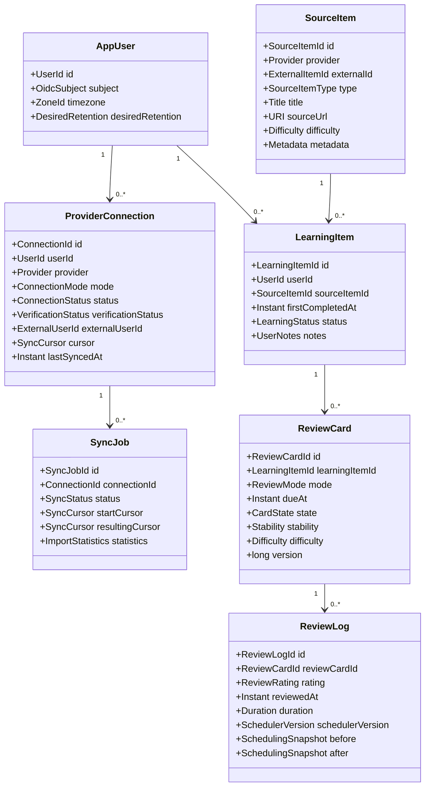
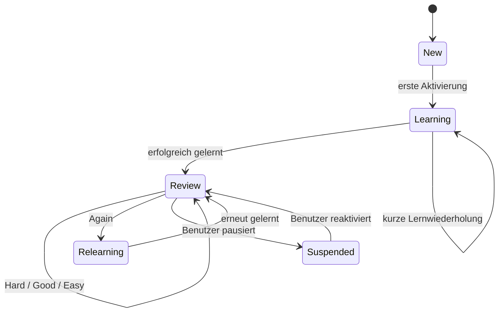

# Domänenmodell

## Aggregate und Beziehungen

## Aggregategrenzen

### ProviderConnection Aggregate

Schützt:

- gültige Kombination aus Provider und Verbindungsmodus,
- Zustandsübergänge wie `PENDING`, `ACTIVE`, `DEGRADED`, `REVOKED`,
- Cursor nur nach erfolgreichem Import,
- Referenz auf verschlüsselte Credential-Daten.

Die öffentliche Codewars-Verbindung in Phase 5 verwendet `PUBLIC_PROFILE` und
`UNVERIFIED`, besitzt keine Credential-Daten und behauptet keine
Account-Inhaberschaft. Der Cursor wird erst nach einem vollständig erfolgreichen
SyncJob aktualisiert; bei Teilfehlern bleibt der vorherige Wert erhalten.

### SourceItem Aggregate

Ein Source Item ist anhand `(provider, externalId)` eindeutig. Provider-Metadaten dürfen aktualisiert werden; benutzereigene Informationen gehören niemals hierher.

### LearningItem Aggregate

Schützt:

- Eindeutigkeit `(userId, sourceItemId)`,
- benutzerspezifische Notizen und Status,
- Entscheidung, welche Review-Modi aktiviert sind.

Gemäß [PD-001](../product/phase-3-decisions.md) erzeugt die erste Aktivierung automatisch genau eine `APPROACH_RECALL`-Karte. `FULL_RECODE` wird später nur auf ausdrücklichen Benutzerwunsch zusätzlich aktiviert.

### ReviewCard Aggregate

Schützt:

- genau einen aktuellen Scheduler-Zustand,
- gültige Zustandsübergänge,
- atomare Erzeugung eines Review Logs beim Review-Abschluss,
- konkurrierende Aktualisierung über optimistisches Locking,
- genau-einmalige fachliche Wirkung eines Idempotency Keys.

### SyncJob Aggregate

Schützt:

- nachvollziehbaren Zustand `REQUESTED`, `RUNNING`, `RETRY_SCHEDULED`,
  `SUCCEEDED`, `TERMINAL_FAILED` oder `DEAD_LETTERED`,
- Importstatistik und Fehlerklassifikation,
- Cursor-Fortschritt nur für vollständig übernommene Seiten beziehungsweise Batches.

Der technische Outbox-Zustand bleibt vom fachlich sichtbaren SyncJob getrennt.
Ein abgelaufenes Lease erlaubt at-least-once-Redelivery; die fachliche
Idempotenz verhindert dabei doppelte LearningItems.

## Zentrale Invarianten

1. Benutzer dürfen ausschließlich eigene Provider Connections, Learning Items, Review Cards und Review Logs sehen.
2. Ein Learning Item referenziert genau ein Source Item.
3. Pro Benutzer und Source Item existiert höchstens ein aktives Learning Item.
4. Pro Learning Item und Review-Modus existiert höchstens eine aktive Review Card.
5. Ein abgeschlossener Review erzeugt genau einen ReviewLog-Eintrag und einen neuen Card-Zustand.
6. Review Logs werden nicht verändert oder gelöscht, außer im Rahmen einer vollständigen Benutzerlöschung nach definierter Datenschutzregel.
7. Scheduler-Berechnungen erhalten explizite Zeit und Parameter; sie lesen keine Systemzeit selbst.
8. Ein Provider-Import darf manuelle Notizen oder Review-Zustände niemals überschreiben.
9. Ein wiederholter Import desselben Provider-Elements erzeugt keine Dublette.
10. Verschlüsselte Credentials werden niemals in fachliche Events oder Telemetrie kopiert.

## Review-Ablauf

Der FSRS-Zustandsautomat verwendet gemäß [ADR-0015](../adr/0015-java-fsrs-6-adapter.md)
die Zustände `LEARNING`, `REVIEW` und `RELEARNING`. Ein neuer Inhalt beginnt in
`LEARNING`. Für Lernen und Wiederlernen gilt jeweils ein zehnminütiger Schritt;
anschließend bestimmt FSRS-6 das nächste Intervall aus Stability, Difficulty,
tatsächlichem Review-Zeitpunkt und gewünschter Retention. Vorgezogene Reviews
verwenden gemäß [PD-003](../product/phase-4-decisions.md) unverändert ihren realen
Zeitpunkt.

## Lösch- und Aufbewahrungsregeln

Gemäß [PD-009](../product/phase-8-decisions.md) gilt:

- Trennen eines Providers löscht oder invalidiert Credentials und stoppt neue Syncs.
- Importierte Source Items können geteilt bleiben, solange keine personenbezogenen Daten enthalten sind.
- Benutzerbezogene Learning Items, Review Cards und Review Logs werden bei
  vollständiger Kontolöschung entfernt. Dasselbe gilt für Provider-
  Verbindungen, SyncJobs, zugehörige Outbox Events und den `AppUser`.
- Verwaiste Source Items werden gelöscht; von anderen Benutzern referenzierte
  Source Items bleiben als geteilte, nicht benutzerspezifische Metadaten
  erhalten.
- Der externe OIDC-Account ist vom ReviewHop-Benutzer getrennt und wird nicht
  durch die Fachdatenlöschung verändert.
- Audit- und Betriebsdaten besitzen dokumentierte Aufbewahrungsfristen.
