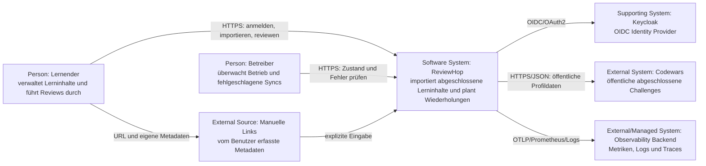

# C4 Level 1 – Systemkontext

## Zweck

ReviewHop unterstützt Lernende dabei, bereits bearbeitete Lerninhalte erneut aktiv zu erinnern oder anzuwenden. Das System importiert ausschließlich erlaubte Metadaten, plant Reviews und führt eine benutzerspezifische Historie.

## Kontextdiagramm

## Akteure

### Lernender

- meldet sich über OIDC an,
- verbindet unterstützte Provider oder erfasst Lerninhalte manuell,
- entscheidet, welche Inhalte wiederholt werden,
- führt Reviews durch und bewertet das Ergebnis,
- verwaltet eigene Notizen, Export und Löschung.

### Betreiber

- betreibt die Demo-/Staging-Umgebung,
- beobachtet Verfügbarkeit, Kosten, Sync-Fehler und Dead-Letter-Queues,
- kann fehlgeschlagene technische Aufträge wieder anstoßen,
- darf keine geheimen Provider-Credentials oder unnötigen Lerninhalte einsehen.

## Externe Systeme

### OIDC Identity Provider

Keycloak bestätigt die Benutzeridentität und verwaltet den Account. ReviewHop verwaltet keine Passwörter. Lokale und öffentliche Umgebung verwenden gemäß [ADR-0013](../adr/0013-keycloak-oidc-and-bff-session.md) denselben OIDC-Vertrag; das optionale AWS-Deployment darf einen kompatiblen Provideradapter verwenden.

### Codewars

Erster automatischer Lernprovider. ReviewHop liest öffentliche Profil- und Abschlussmetadaten über die dokumentierte API. Eine Verbindung über einen Benutzernamen bestätigt nicht die Inhaberschaft des Codewars-Kontos.

### Manuelle Quelle

Ein Benutzer erfasst URL, Titel und eigene Metadaten. Die Quelle ist ein interner Provider-Typ und keine automatisierte Fremdsystemintegration.

### Observability Backend

Empfängt Telemetrie über herstellerneutrale OpenTelemetry-Schnittstellen. Die konkrete Hostingentscheidung für Grafana, Loki und Tempo ist noch offen.

## Systemgrenze und Verantwortlichkeit

ReviewHop ist verantwortlich für:

- benutzerspezifische Lern- und Review-Daten,
- Scheduling und Review-Historie,
- erlaubte Provider-Synchronisation,
- Schutz gespeicherter Credentials,
- Nachvollziehbarkeit fachlicher und technischer Abläufe.

ReviewHop ist nicht verantwortlich für:

- Verfügbarkeit oder fachliche Richtigkeit externer Aufgaben,
- Ausführung fremder Coding-Challenges,
- Eigentumsbestätigung öffentlicher Profile,
- Speicherung vollständiger fremder Aufgabenbestände,
- Passwort- oder Kontoverwaltung externer Plattformen.

## Vertrauensgrenzen

- Browser-Eingaben und Provider-Antworten sind grundsätzlich nicht vertrauenswürdig.
- OIDC-Tokens müssen Signatur, Issuer, Audience und Ablaufprüfung bestehen.
- Provider-Antworten werden validiert und auf erwartete Größe begrenzt.
- Administratorzugriff ist getrennt von normalem Benutzerzugriff.
- Telemetrie darf keine Tokens oder geheimen Benutzerdaten enthalten.
