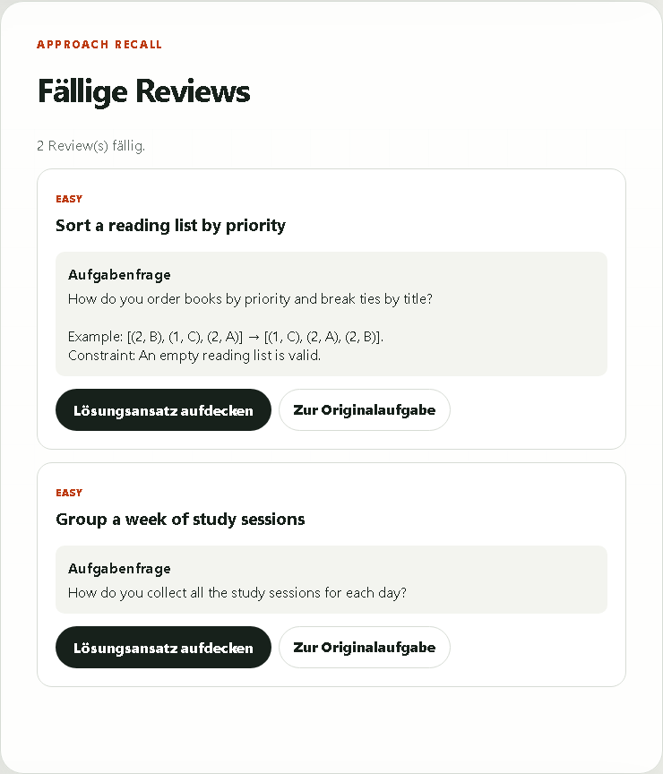
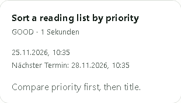

# ReviewHop im Portfolio

ReviewHop macht aus bereits gelösten Aufgaben einen Wiederholungsplan. Lernende
erfassen eigene Aufgabenlinks oder übernehmen Abschlussmetadaten aus einem
öffentlichen Codewars-Profil. Sie bewerten ihre Erinnerung nach jedem Review.
FSRS berechnet daraus den nächsten Termin, und die Historie hält Bewertung
und Folgezeitpunkt fest.

## Lokal ausprobieren

1. Docker mit Compose starten. Im Repository `.env.example` nach `.env`
   kopieren und die Passwort- und Secret-Platzhalter durch unterschiedliche
   Zufallswerte ersetzen. Für `AUTH_SECRET` mindestens 32 zufällige Bytes
   verwenden. Dann aus dem Repository-Stamm starten:

   ```sh
   docker compose up --detach --build --wait
   ```

2. [ReviewHop lokal öffnen](http://localhost:3000/) und **Mit OIDC anmelden**
   wählen. Über **Registrieren** im lokalen Keycloak einen Testbenutzer
   erstellen und das Profil ausfüllen. Für die Demo reichen erfundene Daten.
3. Unter **Gelöste Aufgabe hinzufügen** Titel und HTTPS-Link eintragen. Für
   die Karte eine Aufgabenfrage in eigenen Worten und den eigenen Lösungsansatz
   ergänzen. Mit **Aktivieren** erscheint die Aufgabe unter **Fällige Reviews**.

   | Titel | HTTPS-Link | Tags |
   | --- | --- | --- |
   | Sort a reading list by priority | `https://example.com/reviewhop-demo/reading-list` | `sorting, java` |
   | Group a week of study sessions | `https://example.com/reviewhop-demo/study-sessions` | `collections, java` |

   Für eine LeetCode-Karte lässt sich die gesamte Aufgabenfrage in eigenen
   Worten eintragen, einschließlich Beispielen und Eingabegrenzen. Ein
   Beispiel für „Best Time to Buy and Sell Stock“ mit selbst gewählten
   Beispieldaten:

   > `prices[i]` ist der Aktienkurs am Tag `i`. Wie hoch ist der maximale
   > Gewinn, wenn du höchstens einmal kaufst und erst an einem späteren Tag
   > verkaufst? Gib `0` zurück, falls kein Gewinn möglich ist.
   >
   > `[8, 2, 6, 3]` → `4` · `[4, 3, 1]` → `0`
   >
   > Die Liste enthält 1 bis 100.000 Werte. Jeder Kurs liegt zwischen
   > 0 und 10.000.

4. Bei der Leseliste zuerst die Frage lesen und den Ansatz aus dem Gedächtnis
   formulieren. Dann **Lösungsansatz aufdecken**, optional eine Review-Notiz
   ergänzen und **GOOD** wählen. Unter **Letzte Reviews** erscheinen Bewertung
   und nächster Termin. **Zur Originalaufgabe** öffnet den Aufgabenlink für
   eine erneute Umsetzung.
5. Optional im Datenschutzbereich den JSON-Export herunterladen. Zum
   Beenden im Repository-Stamm `docker compose down` ausführen. Die lokalen
   Daten bleiben für den nächsten Start gespeichert.

Die beiden Aufgaben und ihre Links sind synthetische Beispiele. Der Ablauf
funktioniert ohne Konto bei einer Lernplattform. Codewars ist ein optionaler
Import über ein öffentliches, unverifiziertes Profil. LeetCode-Links lassen
sich manuell erfassen.

## Screenshots

Fällige Reviews auf dem Desktop. Die Vorderseite zeigt die Aufgabenfrage
mit Beispielen und Eingabegrenzen. Der Lösungsansatz bleibt verdeckt.



Abgeschlossener Review mit Bewertung, Notiz und nächstem Termin bei
mobiler Bildschirmbreite.



## Technische Entscheidungen für das Bewerbungsgespräch

- **Backend:** Java 21 und Spring Boot 3 bilden den modularen Monolithen.
  Hexagonale Modulgrenzen halten Fachlogik und FSRS vom Web- und
  Persistenzcode unabhängig. ArchUnit und Spring Modulith prüfen die
  Architektur. [C4-Komponentenmodell](../architecture/backend-components.md)
- **Zuverlässigkeit:** PostgreSQL hält Fachdaten und die Transactional
  Outbox. Ein separater Worker verarbeitet Codewars-Aufträge mit
  begrenzten Wiederholungen und toleriert erneute Zustellung. Parallele
  idempotente Schreibzugriffe und Provider-Ausfälle sind getestet.
  [Outbox-Entscheidung](../adr/0017-postgresql-outbox-worker.md)
- **Betrieb:** Next.js führt die Sitzung serverseitig mit Keycloak.
  Docker Compose und Terraform bilden die Hetzner-Topologie ab. Metriken,
  Logs und Traces helfen bei der Fehlersuche.
  [C4-Containerdiagramm](../architecture/container-diagram.md)

## Lebenslauf

**ReviewHop · Java-Backend-Portfolio** – Spaced-Repetition-Anwendung mit
Java 21, Spring Boot, PostgreSQL und FSRS entwickelt. Codewars-Import über
Transactional Outbox und separaten Worker umgesetzt. Idempotenz,
Benutzerisolation und Modulgrenzen mit JUnit 5, Testcontainers und
ArchUnit geprüft. Betrieb mit Docker Compose, Terraform und OpenTelemetry
vorbereitet.

## Artefakte und Veröffentlichungsstand

GitHub Actions erzeugt die Screenshots im temporären Test-Stack sowie
CycloneDX-Software-Stücklisten der gebauten Backend-, Frontend-, Keycloak-
und Backup-Images. Die Artefaktnamen enthalten die Commit-ID. Der Worker
verwendet dasselbe Image wie das Backend.

Für eigene Screenshots den [Browser-Test einrichten](../../README.md#checks-ausführen)
und ein frisches Testkonto mit den dort beschriebenen `E2E_ALICE_*`-Variablen
verwenden. Im Verzeichnis `frontend` unter PowerShell ausführen:

```powershell
$env:ANKILEET_PORTFOLIO_SCREENSHOTS = 'test-results/portfolio'
npm run test:e2e -- --project chromium --grep 'captures the portfolio'
```

Zur lokalen Wiederholung der
Inventarisierung die Images wie im CI-Job `Container build` bauen und aus
dem Repository-Stamm `bash scripts/generate-sboms.sh` ausführen. Die
JSON-Dateien landen standardmäßig unter `artifacts/sbom/`.

Die interaktive Demo ist lokal verfügbar. Der öffentliche Hetzner-Termin
hängt von CI für den Release-Commit, dem abgeschlossenen Security Review,
Domain- und Betriebsfreigaben, einem HTTPS-Nachweis sowie einem Restore aus
dem externen Backup ab. [Phase-8-Nachweis](../plans/phase-8-verification.md)
· [Hetzner-Betrieb](../operations/hetzner-demo-runbook.md)
