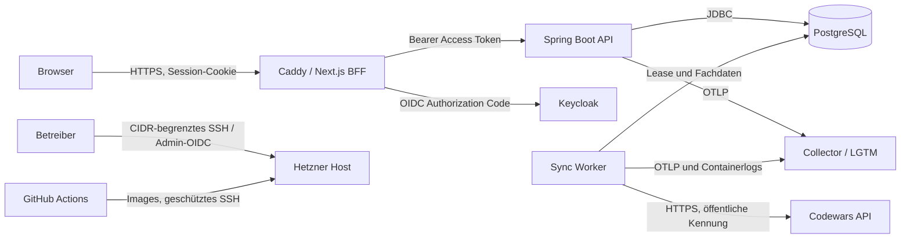

# Threat Model

- Stand: 2026-11-24
- Scope: lokaler Betrieb, primäre Hetzner-Demo und CI/CD
- Methode: datenflussorientierte STRIDE-Analyse
- Status: initiale Phase-8-Baseline

## Sicherheitsziele

1. Ein Benutzer kann ausschließlich eigene Provider-Verbindungen,
   Learning Items, Review Cards, Review Logs und SyncJobs lesen oder verändern.
2. OIDC-, Provider-, Datenbank-, Deployment- und Backup-Secrets gelangen weder
   in Browser-JavaScript noch in Repository, Logs oder Telemetrie.
3. Reviews, Importe und asynchrone Aufträge bleiben bei Wiederholung und
   Prozessabbruch fachlich konsistent.
4. Fremde Lernplattformen werden nur über erlaubte Schnittstellen und mit
   minimal gespeicherten Metadaten verwendet.
5. Die öffentliche Demo kann begrenzt, beobachtet, gesichert und kontrolliert
   wiederhergestellt oder zurückgebaut werden.

## Schützenswerte Assets

| Asset | Schutzbedarf | Begründung |
|---|---|---|
| OIDC-Identität und BFF-Session | Hoch | Missbrauch ermöglicht Zugriff im Namen eines Benutzers. |
| Anwendungs- und Keycloak-Datenbanksecrets | Kritisch | Ermöglichen direkten Zugriff auf Identitäts- oder Fachdaten. |
| Hetzner-, SSH-, Registry- und Terraform-Zugänge | Kritisch | Ermöglichen Infrastruktur- oder Supply-Chain-Manipulation. |
| Learning Items, Notizen und Review-Historie | Hoch | Benutzerbezogene Lern- und Verhaltensdaten. |
| Provider-Verbindungen und externe Kennungen | Mittel | Öffentliche Kennung, aber benutzerbezogene Zuordnung. |
| SyncJobs und Outbox Events | Hoch | Steuern externe Verarbeitung und enthalten interne Korrelation. |
| Backups und Terraform-State | Kritisch | Können vollständige Datenbestände oder Infrastrukturdetails enthalten. |
| Logs, Metriken und Traces | Mittel bis hoch | Können bei fehlerhafter Instrumentierung interne oder personenbezogene Daten offenlegen. |
| Container-Images und CI-Konfiguration | Hoch | Manipulation wirkt auf alle Deployments. |

## Vertrauensgrenzen und Datenflüsse

Die relevanten Vertrauensgrenzen sind:

- fremder Browser zu öffentlichem Caddy/Next.js,
- BFF zu Java-API und Keycloak,
- Anwendung zu PostgreSQL,
- Worker zu fremder Provider-API,
- Telemetrie-Collector zu Docker-Metadaten und Observability-Speichern,
- GitHub Actions zu Registry und Hetzner-Host,
- Betreiberarbeitsplatz zu SSH, Keycloak-Administration und Terraform.

## Bedrohungen und Kontrollen

| ID | STRIDE | Bedrohung | Bestehende Kontrolle | Restrisiko / Folgearbeit |
|---|---|---|---|---|
| TM-01 | Spoofing | Gefälschtes oder für eine andere API ausgestelltes JWT | Fester OIDC-Issuer, JWK-Prüfung, Audience `ankileet-api`, Zuordnung über Issuer und Subject | Keycloak-Patchstand und Runtime-Mitigation vor öffentlichem Betrieb erneut prüfen. |
| TM-02 | Spoofing | Diebstahl des BFF-Session-Cookies | Verschlüsseltes HttpOnly-Cookie, serverseitige Tokenverwendung, einstündige Session, HTTPS/HSTS öffentlich | Content Security Policy und Session-Widerruf im Security-Review weiter härten. |
| TM-03 | Tampering | Benutzer verändert fremde Lern- oder Sync-Daten | Serverseitige Ownership-Prüfung und Zwei-Benutzer-Integration-/E2E-Tests | Neue benutzereigene Aggregate benötigen denselben Negativtest. |
| TM-04 | Tampering | Doppelte Reviews oder Imports durch Retry/Replay | Idempotency Keys, Unique Constraints, optimistisches Locking, Transactional Outbox | Last- und Konkurrenztests in Phase 8 ergänzen. |
| TM-05 | Repudiation | Operator- oder Sicherheitsaktion ist nicht nachvollziehbar | Keycloak-Events, strukturierte Sync-Logs, Trace- und Correlation-ID; Export und Löschung mit datensparsamen Audit-Logs und Metriken | Operator-Retry und gemeinsame Audit-Retention ergänzen. |
| TM-06 | Information Disclosure | Token oder Secret erscheint in Repository oder Build-Artefakt | Umgebungsvariablen, Platzhalter, Trivy-Image-Scans | Blockierender Repository-Secret-Scan wird in Phase 8 ergänzt. |
| TM-07 | Information Disclosure | Personenbezogene Daten gelangen in Logs, Metriklabels oder Traces | Keine Benutzer-/Accountnamen in Telemetrie, niedrig kardinale Labels, interne IDs nur in Logs | Bei neuen Events gezielte Log- und Telemetrieprüfung erforderlich. |
| TM-08 | Information Disclosure | BFF gibt Backend- oder Tokeninformationen an den Browser weiter | Eng begrenzte BFF-Routen, Access Token nicht in sichtbarer Session, Antwortweiterleitung nur für Body/Content-Type | Fehlerantworten und Exportdownload auf minimale Header prüfen. |
| TM-09 | Denial of Service | Öffentliche Endpunkte oder Login werden überlastet | Kleine Request-Timeouts, asynchroner Provider-Sync, begrenzte Retries, subjektbezogene Lese-/Schreiblimits, k6-Kapazitätsbudgets und Keycloak-Brute-Force-Schutz | Reale Hetzner-Kapazität nach Deployment erneut messen. |
| TM-10 | Denial of Service | Providerfehler füllen Queue, Logs oder Datenbank | Fünf Versuche, Backoff/Jitter, Dead Letter, Observability-Alerts | Outbox-Aufbewahrung und Bereinigung vor Release festlegen. |
| TM-11 | Elevation of Privilege | Anwendung führt Schemaänderungen aus | Getrennte Migrator- und Application-Rollen, explizite DML-Grants | Grants bei jeder neuen Migration testen. |
| TM-12 | Elevation of Privilege | Alloy oder kompromittierter Container kontrolliert Docker | Eingeschränkter, read-only Socket-Proxy; kein direkter Socket für Alloy | Proxy-Image und erlaubte Endpunkte bei Updates erneut prüfen. |
| TM-13 | SSRF | Benutzer veranlasst Serverzugriff auf beliebige URL | Manuelle Links werden nicht serverseitig geladen; Codewars-Ziele entstehen aus konfigurierter Basis-URL und validiertem Slug | Neue URL-basierte Provider benötigen explizite Allowlist-Tests. |
| TM-14 | Supply Chain | Manipulierte Dependency, Action oder Containerbasis | Lockfile, Maven BOM, unveränderliche App-Image-Tags beim Deployment, Trivy und npm Audit | GitHub Actions sind noch nicht auf Commit-SHAs fixiert; SBOM fehlt. |
| TM-15 | Tampering / Disclosure | Unsicheres oder manipuliertes Backup | Getrennte logische Dumps, Restic-Verschlüsselung, begrenzte Retention und isolierter lokaler Restore | Object-Storage-Apply und realer externer Restore-Test sind Release-Blocker. |
| TM-16 | Information Disclosure | Fremde Aufgabeninhalte werden unzulässig gespeichert oder veröffentlicht | Nur minimale Metadaten; LeetCode bleibt manuell; Codewars über öffentliche API | Demo-Daten und Screenshots vor Release auf Rechte und Personenbezug prüfen. |

## Missbrauchsfälle

- Ein angemeldeter Benutzer errät eine fremde ReviewCard-ID und versucht Lesen,
  Abschluss oder History-Zugriff.
- Ein Angreifer wiederholt denselben Review- oder Sync-Request parallel.
- Eine manipulierte Providerantwort liefert extrem lange Felder, ungültige Slugs,
  viele Seiten oder wiederholt Fehlerstatus.
- Ein kompromittierter BFF-Prozess versucht Tokens zu loggen oder an einen
  fremden Host weiterzuleiten.
- Ein Pull Request enthält ein echtes Token, eine private Schlüsseldatei oder
  eine bösartige Dependency.
- Ein Angreifer erzeugt so viele Sync-Aufträge, dass Worker, Outbox oder
  Telemetriespeicher erschöpft werden.
- Ein Backup wird kopiert, verändert oder in die falsche Umgebung eingespielt.
- Ein Operator löscht einen Account oder startet Dead-Letter-Arbeit erneut,
  ohne dass der Vorgang später nachvollzogen werden kann.

## Verifikationsstrategie

- JUnit/Testcontainers für Autorisierung, Idempotenz, Konkurrenz und
  Datenbankrollen,
- WireMock für Providergrenzen, Timeouts, ungültige Antworten und Rate Limits,
- Playwright für BFF/OIDC und Benutzerisolation,
- Trivy für IaC, Images und Repository-Secrets sowie npm Audit für JavaScript,
- Backup-/Restore-Test in einer isolierten Datenbank,
- k6-Lasttest mit festem Budget, paralleler PostgreSQL-Idempotenztest sowie
  WireMock-/Worker-Ausfalltests,
- manueller Release-Review für Demo-Daten, Screenshots, offene Findings und
  Betriebsfreigaben.

Das Modell wird aktualisiert, sobald ein neuer Provider, ein neuer öffentlicher
Endpunkt, ein zusätzlicher Secret-Pfad oder eine neue Deploymenttopologie
eingeführt wird.
